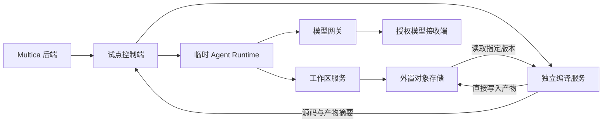

# Q0 隔离试点验收

试点验证一条交付链路。Multica 发出任务，DSH 通过工作区服务保存受控源码。独立编译服务按源码摘要取件并构建，由编译服务把产物直接写入存储。Multica 收到版本和产物摘要后完成任务。



Runtime 只加入工作区和网关所在的私有网络。工作区、网关分别通往存储和模型网络。试点控制端领取与完成 Multica 任务，编译服务通过独立凭据访问对象存储。固定提交来自 [上游版本锁](../upstreams.lock.json)，通过官方 Multica–DSH 桥接运行单 Agent。Linux 容器按服务和网络划分，同一次 CI 的服务在一台 Linux runner 上运行。

## 怎样判断通过

| 验收项 | 对照证据 |
| --- | --- |
| Multica 任务闭环 | `backend` 中的工作区、任务编号与最终状态，可关联接收端的 `work`。 |
| 保存、编译、直存 | Agent 工具结果、工作区确认、编译读件及存储读取的源码摘要一致。编译回执的产物摘要与存储实际字节一致，写入者为 `compiler`，三个结果分别为 21、0、200。 |
| Runtime 挂载与凭据 | 容器配置和运行进程分别确认无持久卷、根文件系统只读、可写工作目录为 tmpfs。运行进程仅持有本任务的 10 分钟租约。数据库、存储和编译服务凭据由对应服务持有。 |
| 模型与存储隔离 | 从 Runtime 探测运行中接收端的实际地址。工作区和网关可达，存储、编译服务与模型接收端的直连均不可达。用同一版本源码调用未授权模型时，网关返回 403，目标接收端记录为零。 |

## 复跑

在仓库根目录执行。需要 Docker，以及构建镜像和下载模型的网络。每次运行创建独立资源，退出后清理这些资源并保留证据。

```sh
python3 pilot/run.py --build
```

[Q0 pilot deployment 工作流](https://github.com/fREEDtICE/software-delivery-workbench/actions/workflows/q0-pilot.yml) 使用同一入口。下载该次运行的 `q0-pilot-deployment`，查看 `deployment.json` 中的部署、接收端、Runtime 和任务证据，以及 `images-build.log` 中的构建记录。

本轮限于合成源码、单任务租约和私有容器网络。恢复和撤权在后续验收。

## 本机复跑证据

[本机部署和接收端记录](q0-pilot-local-evidence.json)来自独立 Linux 虚拟机中的试点复跑。工作区、编译、存储和 Runtime 在虚拟机内各自运行。模型接收端经专用转发连接本机 Ollama，Runtime 对该转发端的直连探测也被网络隔离拦住。
